# Hey! I'm Sean Mullens, a senior at Highland Park HS in Dallas, heading into Computer Science.

<!-- Badges and clickables -->
<!-- Universal formatting: label color is always #353537 -->

<!-- Badge formatting: logos are white, background color is the language's brand color -->

<!-- "About me" bullet points -->

- Lead programmer on my school's robotics team: drone and ground-robot control code in Python, ROS 2, and Arduino
- Want to connect? Reach me at [mullenssean2@gmail.com](mailto:mullenssean2@gmail.com)

---

    
    

